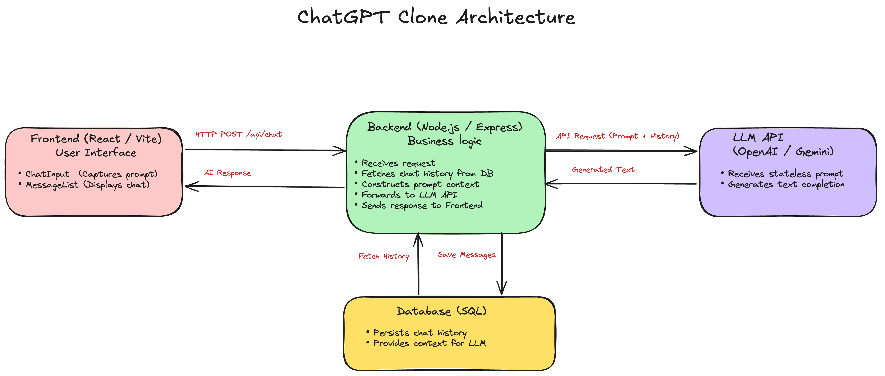

# ChatGPT Clone

A full-stack chat app inspired by ChatGPT. You ask a question, the backend sends it to **Google Gemini** together with recent conversation history, and the reply appears in a chat interface with Markdown and code highlighting. Every message is saved in MySQL, so the conversation is still there after a refresh.

Built during the [Evangadi](https://www.evangadi.com/) full-stack bootcamp (Phase 4).



---

## Features
- ChatGPT-style interface: sidebar, header, scrolling message list and input box
- AI replies from Google Gemini, rendered as Markdown with syntax-highlighted code blocks
- **Conversation memory** – the last few messages are sent along with each question, so follow-up questions make sense
- Messages saved to MySQL (with token counts) and reloaded on page load
- Instant feedback: your message shows right away while the AI is thinking
- Centralized error handling with clear messages (validation, database, AI provider errors)

## Tech Stack

| Layer    | Tools |
|----------|-------|
| Frontend | React 19, Vite, Axios, React Markdown, React Syntax Highlighter, Lucide icons |
| Backend  | Node.js, Express 5, `@google/genai` |
| Database | MySQL (`mysql2`) |

## How it works

```
React ──POST /api/chat/conversations──▶ Express
                                          │ 1. load recent history from MySQL
                                          │ 2. save the user's question
                                          │ 3. ask Gemini (question + history)
                                          │ 4. save the assistant's reply
React ◀────────── both messages ──────────┘
```

## Project Structure

```
backend/
  index.js                 starts the server after the DB connects
  src/app.js               Express app, routes, 404 + error handler
  src/routes/              chatRoutes.js
  src/controllers/         chatController.js
  src/services/            aiService.js (Gemini)
  src/config/db.js         MySQL pool + creates the conversations table
  src/middleware/          errorHandler.js
  src/utils/               AppError.js (custom error classes)
frontend/
  src/App.jsx              state + API calls
  src/components/          Sidebar, ChatHeader, MessageList, ChatMessage, ChatInput
```

## Getting Started

### Prerequisites
- Node.js 18+
- MySQL 8+
- A Google Gemini API key – get one at [Google AI Studio](https://aistudio.google.com/)

### 1. Clone
```bash
git clone https://github.com/abeselom20/chatgpt-clone.git
cd chatgpt-clone
```

### 2. Database
Just create an empty database – the `conversations` table is created automatically when the server starts:
```bash
mysql -u root -p -e "CREATE DATABASE chatgpt_clone;"
```

### 3. Backend
```bash
cd backend
npm install
cp .env.example .env
```
Fill in `backend/.env`:

| Variable | What it is |
|----------|-----------|
| `PORT` | API port (default `3777`) |
| `DB_HOST`, `DB_PORT`, `DB_USER`, `DB_PASSWORD`, `DB_NAME` | Your MySQL connection |
| `GEMINI_API_KEY` | Your Gemini API key |
| `GEMINI_MODEL` | Gemini model to use |
| `GEMINI_MAX_OUTPUT_TOKENS` | Max length of a reply |
| `GEMINI_HISTORY_LIMIT` | How many past messages to send as context |

```bash
npm run dev
```

### 4. Frontend
In a second terminal:
```bash
cd frontend
npm install
npm run dev
```
Open the URL Vite prints (usually `http://localhost:5173`). The frontend expects the API at `http://localhost:3777/api`.

## API

| Method | Endpoint | Description |
|--------|----------|-------------|
| GET  | `/api/chat/conversations` | All saved messages, oldest first |
| POST | `/api/chat/conversations` | Body `{ "question": "..." }` → returns the saved question and the AI reply |

## Author

**Adamu** – [@abeselom20](https://github.com/abeselom20)
